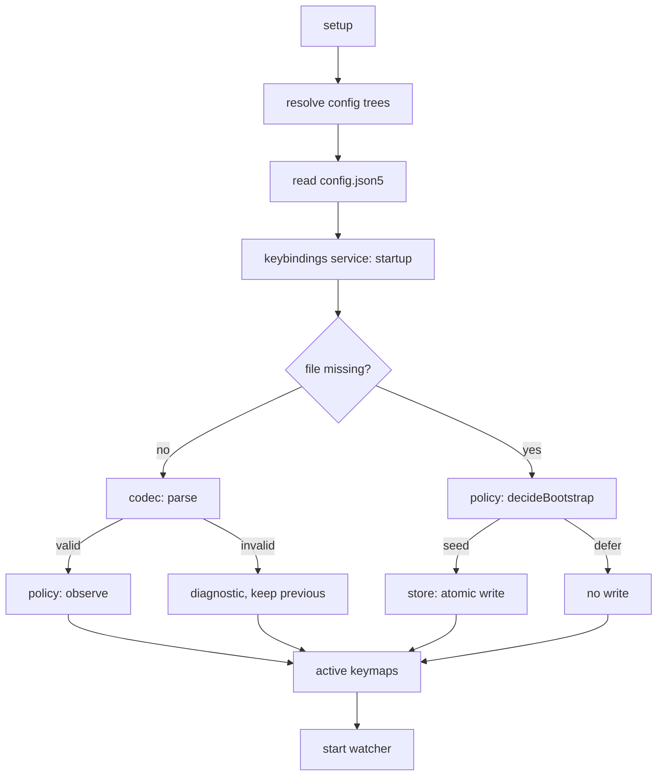

# Configuration architecture

## Module header

- Purpose: describe how Velocetty loads, validates, stores, watches, and
  migrates its configuration files, and where the verified core ends and the
  trusted adapters begin.
- Invariants: every component named here exists under `app/config` or
  `shared/src/config`; the verified module `app/config/keybindings-policy.ts`
  stays free of Electron, filesystem, and clock access.
- Cross-links:
  - [ADR 007](adr-007-keybindings-json5-storage.md)
  - [ADR 008](adr-008-velocetty-configuration-directory.md)
  - [Users' guide](users-guide.md)
  - [Developers' guide](developers-guide.md)

## Shape

Configuration is a hexagonal design. A small, pure policy decides what may
happen; thin adapters carry out the decisions against files, the filesystem
watcher, and the user interface. The policy is the only part that is formally
verified, so the untrusted parts stay small enough to test by example and
property.

| Layer       | Modules                                                                                  | Depends on                     |
| ----------- | ---------------------------------------------------------------------------------------- | ------------------------------ |
| Policy      | `app/config/keybindings-policy.ts`                                                       | nothing (pure functions)       |
| Codec       | `app/config/keybindings-codec.ts`                                                        | `json5`, `zod`                 |
| Service     | `app/config/keybindings.ts`                                                              | codec, policy, store port      |
| Importer    | `app/config/import.ts`, `import-keybindings.ts`, `import-report.ts`, `import-sources.ts` | service, legacy config         |
| Paths       | `app/config/config-tree.ts`, `app/config/paths.ts`                                       | injected filesystem predicates |
| Store       | `app/config/keybindings-store.ts`                                                        | `node:fs`                      |
| Watcher     | `app/config/watcher.ts`                                                                  | injected scheduler and handle  |
| Composition | `app/config.ts`, `app/config/init.ts`, `reload-handler.ts`                               | all of the above, Electron     |

_Table 1: Configuration components._

### Policy

`keybindings-policy.ts` holds the two decisions that must not be wrong:

- **last known good**: an observation (a read outcome) either replaces the
  active user keymaps or leaves them alone. An invalid or unreadable file never
  clears working shortcuts;
- **bootstrap**: `decideBootstrap` decides whether a start-up may create
  `keybindings.json5`, and with what content. Only a missing file may be
  written. It seeds the legacy keymaps when they parsed, `{}` when the legacy
  config is empty or was just created, and nothing when the legacy config is
  invalid or the source fell back to defaults.

Both are LemmaScript contracts in `app/config/keybindings-policy.dfy`. The
module is pure by construction: no Electron import, no `node:fs`, no clock. The
contracts are `observeKeybindings`, `activeKeymaps`, `decideBootstrap`, and
`bootstrapObservation`, each stated as a `*_ensures` lemma over the shipped
function.

### Codec

`keybindings-codec.ts` is the trust boundary. Text comes from a file the user
edits, so parsing must terminate for any input, and every rejection carries a
`configValidationDiagnostic` with a path, a message, and a suggested fix. It
also owns the canonical writer used only when the file is first created (sorted
keys, two-space JSON5, a header comment), and the `$schema` rule: a string is
accepted and dropped, anything else is rejected.

`app/config/keybindings.schema.json` is the editor-facing schema for the file.
`test/unit/keybindings-schema-parity.test.ts` keeps the schema and the codec in
step.

### Service

`keybindings.ts` owns the in-memory last-known-good state and the two phases a
file passes through:

- **start-up** (`import('startup')`): read the file. If it is missing, ask the
  policy whether to seed it, and write only if the policy says so;
- **reload** (`import('reload')`): read and observe. It never writes.

The service talks to the filesystem through the `KeybindingsStore` port, whose
methods are `read` and `write`. A missing file is an accepted observation, so
"no overrides" is a state, not an error. Import is verbatim: the text is
validated and stored unchanged, so a user's comments survive.

### Store

`keybindings-store.ts` is the only module that writes `keybindings.json5`. The
replacement is written to a temporary sibling, flushed, given the target's
mode, and renamed over the target. Any failure removes the temporary file and
leaves the user's file untouched; there is no direct-overwrite fallback.

### Importer

`import.ts` is the only module that knows both configuration files. It
classifies `config.json5`'s legacy `keymaps` (absent, parsed, empty, invalid,
or fallen back), drives the service through start-up or reload, and reports
what each file did. `import-report.ts` turns that report into the
`shouldAnnounceReload` decision, so "Configuration updated" is shown only when
something actually changed. Migration notices fire at most once per process.

### Paths

`config-tree.ts` resolves the Velocetty and Hyper trees as a pure function of
the platform, the environment paths, and two injected filesystem predicates.
Neither tree is probed directly, so every combination is enumerable in tests.
Its `listCandidates` builds the development-mode override and the ordered
`config.json5` candidate list, and `resolveConfigLocations` selects the active
file from them. `shared/src/config/config-tree.ts` mirrors this split for the
command-line interface (CLI), and a parity test keeps the copies in step.
`paths.ts` supplies the Electron inputs — `isDev`, the development directory,
and the `probe` and `sameFile` adapters — and then calls
`resolveConfigLocations`.

### Watcher

`watcher.ts` coalesces a burst of filesystem events into one reload. The
chokidar handle, the scheduler, and the logger are injected, so the debounce
law is tested against a fake clock rather than real time. A reload clears a
pending timer, reads once, and catches a throwing reload so a bad file cannot
stop future reloads.

## Data flow

Start-up resolves the trees, reads both files, seeds only what the policy
allows, then starts the watcher.

A reload is one directory event burst, one read, and one observation.

## Proof and test boundary

| Claim                      | Established by                                                                    |
| -------------------------- | --------------------------------------------------------------------------------- |
| Policy laws                | `make prove` (LemmaScript, Dafny 4.11)                                            |
| Codec parity with schema   | `test/unit/keybindings-schema-parity.test.ts`                                     |
| Service refinement         | `test/unit/keybindings-service.test.ts` and its `.model` and `.property` siblings |
| Atomic writes              | `test/unit/keybindings-store.test.ts`                                             |
| Debounce behaviour         | `test/unit/config-watcher.property.test.ts`                                       |
| Layering                   | `test/unit/config-keymap-layering.property.test.ts`                               |
| Tree resolution and parity | `test/unit/config-tree*.test.ts`                                                  |
| End-to-end behaviour       | `test/e2e/keybindings.e2e.test.ts`                                                |

_Table 2: Where each claim is checked._

`make prove` runs `bin/prove.sh`. It refuses a vacuous success: it fails on an
empty file list, on an entry whose timeout exceeds 60 seconds (`lsc` would
silently downgrade those to generation checks), and on `extern` calls, which it
treats as axioms. The one admitted axiom is `emptyUserKeymaps`, accepted only
on its exact declaration line. `app/config/keybindings-policy.dfy.gen` is
regenerated deterministically from the TypeScript source and is additions-only;
auditing the diff shows that the verified model still matches the shipped code.

Everything below the policy line is trusted-but-tested. The adapters are the
only code allowed to touch Electron, `node:fs`, or real time, which is why each
of them is small and takes its effects as parameters.
