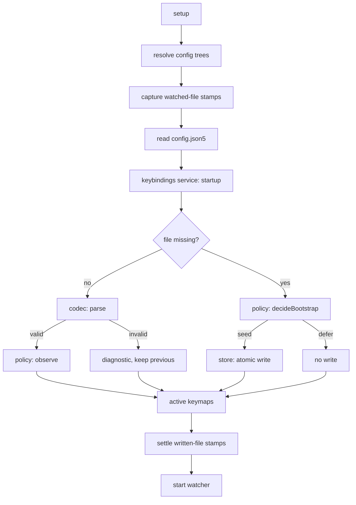

# Configuration architecture

## Module header

- Purpose: describe how Velocetty loads, validates, stores, watches, and
  migrates its configuration files, and where the verified core ends and the
  trusted adapters begin.
- Invariants: every component named here exists under `app/config`,
  `app/config.ts`, `app/plugins-load.ts`, or `shared/src/config`; the verified
  module `app/config/keybindings-policy.ts` stays free of Electron, filesystem,
  and clock access.
- Cross-links:
  - [ADR 007](adr-007-keybindings-json5-storage.md)
  - [ADR 008](adr-008-velocetty-configuration-directory.md)
  - [Users' guide](users-guide.md)
  - [Developers' guide](developers-guide.md)

## Shape

Configuration is a hexagonal design. A small, pure policy decides what may
happen; thin adapters carry out the decisions against files, the filesystem
watcher, and the user interface. The policy is the only part that is formally
verified, so the untrusted parts stay small enough to test by example and
property.

| Layer         | Modules                                                                                  | Depends on                     |
| ------------- | ---------------------------------------------------------------------------------------- | ------------------------------ |
| Policy        | `app/config/keybindings-policy.ts`                                                       | nothing (pure functions)       |
| Codec         | `app/config/keybindings-codec.ts`                                                        | `json5`, `zod`                 |
| Service       | `app/config/keybindings.ts`                                                              | codec, policy, store port      |
| Importer      | `app/config/import.ts`, `import-keybindings.ts`, `import-report.ts`, `import-sources.ts` | service, legacy config         |
| Paths         | `app/config/config-tree.ts`, `app/config/paths.ts`                                       | injected filesystem predicates |
| Store         | `app/config/keybindings-store.ts`                                                        | `node:fs`                      |
| Watcher       | `app/config/watcher.ts`                                                                  | injected scheduler and handle  |
| Observability | `config-metrics.ts`, `config-observability.ts`, `config-spans.ts`, `e2e-keymap-probe.ts` | injected sink and clock        |
| Composition   | `app/config.ts`, `app/config/init.ts`, `app/config/reload-handler.ts`                    | all of the above, Electron     |

_Table 1: Configuration components._

### Policy

`keybindings-policy.ts` holds the two decisions that must not be wrong:

- **last known good**: an observation (a read outcome) either replaces the
  active user keymaps or leaves them alone. An invalid or unreadable file never
  clears working shortcuts;
- **bootstrap**: `decideBootstrap` decides whether a start-up may create
  `keybindings.json5`, and with what content. Only a file the last observation
  found missing may be written; the create itself is not atomic against another
  process, which [#270](https://github.com/leynos/velocetty/issues/270) tracks.
  It seeds the legacy keymaps when they parsed, `{}` when the legacy config is
  empty or was just created, and nothing when the legacy config is invalid or
  the source fell back to defaults.

Both are LemmaScript contracts in `app/config/keybindings-policy.dfy`. The
module is pure by construction: no Electron import, no `node:fs`, no clock. The
contracts are `observeKeybindings`, `activeKeymaps`, `decideBootstrap`, and
`bootstrapObservation`, each stated as a `*_ensures` lemma over the shipped
function.

### Codec

`keybindings-codec.ts` is the trust boundary. Text comes from a file the user
edits, so parsing must terminate for any input, and every rejection carries a
`configValidationDiagnostic` with a path, a message, and a suggested fix. It
also owns the canonical writer used only when the file is first created (sorted
keys, two-space JSON5, a header comment), and the `$schema` rule: a string is
accepted and dropped, anything else is rejected.

`app/config/keybindings.schema.json` is the editor-facing schema for the file.
`test/unit/keybindings-schema-parity.test.ts` keeps the schema and the codec in
step.

### Service

`keybindings.ts` owns the in-memory last-known-good state and the two phases a
file passes through:

- **start-up** (`import('startup')`): read the file. If it is missing, ask the
  policy whether to seed it, and write only if the policy says so;
- **reload** (`import('reload')`): read and observe. It never writes.

The service talks to the filesystem through the `KeybindingsStore` port, whose
methods are `read`, `peek`, and `write`. `read` is the instrumented query used
by the start-up and reload paths; `peek` performs the same read without a span
or a warning, for callers such as `exportKeybindings` that must not report. A
missing file is an accepted observation, so "no overrides" is a state, not an
error. Import is verbatim: the text is validated and stored unchanged, so a
user's comments survive.

### Store

`keybindings-store.ts` is the atomic-write adapter and the only module that
writes `keybindings.json5`. The replacement is written to a temporary sibling,
flushed, given the target's mode, and renamed over the target. A symlinked
target, a dangling chain included, is resolved first so the link survives; a
cycle, an over-long chain, a read-only target, or a resolution failure is
refused before anything is created. Any failure removes the temporary file and
leaves the user's file untouched; there is no direct-overwrite fallback.

Two collaborators are split out so neither retry policy nor reporting hides in
the filesystem work. `keybindings-rename-retry.ts` retries a rename only for
`EPERM`, `EACCES`, and `EBUSY`, up to five attempts about 40 ms apart, reports
each refusal with a bounded category, and rethrows once the retries are
exhausted. `keybindings-store-reporting.ts` wraps the adapter to emit the read
and write spans, count every failed write, and log one bounded warning per
failure route; `peek()` stays a plain read, so export adds no telemetry.

### Importer

`import.ts` is the only module that knows both configuration files. It
classifies `config.json5`'s legacy `keymaps` (absent, parsed, empty, invalid,
or fallen back), drives the service through start-up or reload, and reports
what each file did. `import-report.ts` turns that report into the
`shouldAnnounceReload` decision, so "Configuration updated" is shown only when
something actually changed. Migration notices fire at most once per process.

The importer is composed from four narrower modules. `import-defaults.ts` is
the read-only query for the bundled defaults and the shipped platform keymap:
it never creates a directory, copies a schema, notifies, or writes a log, and
it returns a fault instead of announcing one. `import-bootstrap.ts` owns the
start-up writes — plugin directories, schema copies, and the `config.json5`
template — and gates every one on the phase, so a reload composes the same
loader and writes nothing. `import-faults.ts` holds the once-per-process notice
policy, so a reload cannot repeat a notice the user has already seen, and
`import-fault-logging.ts` holds the bounded log wording, so the query stays
silent and each boundary cannot describe a fault differently.
`import-sources.ts` is the composition that wires the four together and adds
the user-config read that both phases share.

### Paths

`config-tree.ts` resolves the Velocetty and Hyper trees as a pure function of
the platform, the environment paths, and two injected filesystem predicates.
Neither tree is probed directly, so every combination is enumerable in tests.
Its `listCandidates` builds the development-mode override and the ordered
`config.json5` candidate list, and `resolveConfigLocations` selects the active
file from them. `shared/src/config/config-tree.ts` mirrors this split for the
command-line interface (CLI), and a parity test keeps the copies in step.
`paths.ts` supplies the Electron inputs — `isDev`, the development directory,
and the `probe` and `sameFile` adapters — and then calls
`resolveConfigLocations`. The probe is four-state: only `ENOENT` and `ENOTDIR`
establish `absent`, so any other fault — a permission or I/O error, a symlink
loop, or an unclassifiable error — is `inaccessible`. An unreadable file is
therefore reported as the active path with `inspection: 'inaccessible'`, and
start-up keeps the defaults instead of creating a file that could shadow it.
Both sides build the probe with `createPathProbe`, so the `stat`-then-`lstat`
sequence and its error codes have one definition per copy.

### Plugin loader

`app/plugins-load.ts` is an injected-dependency factory that turns the
configured plugin directories into modules. `createPluginLoader` takes the
extension names that make a module a plugin, a `requireModule` rooted at the
plugin directory, and the console and notification sinks; it returns a loader
for one flat list. A module that exposes no extension API, or that throws while
being required, is reported and skipped, so one broken third-party plugin
cannot stop the window from opening. Console lines number a plugin by its
1-based position in the configured list, while a notification names it, because
the user has to find the entry in their own configuration. Neither sink repeats
the directory path or the manifest version.

### Watcher

`watcher.ts` coalesces a burst of filesystem events into one reload. The
chokidar handle, the scheduler, and the logger are injected, so the debounce
law is tested against a fake clock rather than real time. A reload clears a
pending timer, reads once, and catches a throwing reload so a bad file cannot
stop future reloads.

Chokidar's initial scan suppresses events for a file that changed after the
start-up import but before the watcher became ready. On readiness,
`createConfigWatcher` calls `reconcileOnReady`; the composition root passes a
predicate built by `createWatchedFileReconciler`, which compares each watched
file's stamp with the baseline it captured _before_ the import read them and
runs one catch-up reload when any file moved or could not be inspected.
Capturing before the read is what makes a save landing after that read visible;
capturing afterwards would record the file's new identity while the application
still held the old content. The files start-up itself writes — a bootstrapped
`config.json5` or a seeded `keybindings.json5` — are settled to their new
identity only while each still holds the exact text the import applied; a file
edited in between keeps its earlier identity, and a written file since deleted
settles to an unknown identity, so both differences still reconcile.

### Watched-file stamps

`watched-file-stamp.ts` sits between the importer and the watcher. The
composition root captures the baseline before `_import('startup')` runs, passes
the files that import wrote to `settleWatchedFileStamps`, and hands the settled
baseline to the watcher runtime's `watch` method. `readWatchedFileStamp`
records a tri-state identity — `present` with size and modification time,
`absent` for `ENOENT`, and `unreadable` for any other failure — and
`stampsMatch` treats an unknown identity as never equal to anything, including
another unknown one. The third state exists because reading every failure as
"absent" let two failures compare equal, so a save during a failing inspection
could go unreconciled. `captureWatchedFileStamps` reads the whole set, and
`createWatchedFileReconciler` turns the baseline into the readiness predicate.

### Applied state and queries

The configuration root is split so that storage, reading, and watching are not
owned by the module that wires them. `current-config.ts` is the single owner of
the applied configuration: only the composition root writes it, once an import
has produced a whole config, and `getCurrentConfig` throws rather than returning
`undefined`, so a caller that runs before `setup()` fails loudly.
`config-queries.ts` is the read surface — the profile, keymap, plugin, and
deprecation queries plus the decoration helpers — and reads the applied state
directly, so a window that opens after a reload sees the configuration in
effect. `config-watch.ts` owns the subscriber list, the reload command, the
chokidar adapter, and the readiness reconciliation; the importer and the
recorder, span, metric, notification, and marker sinks arrive as explicit
parameters. `app/config.ts` keeps only the composition: it builds the adapters
and the start-up command and re-exports the query surface.

### Observability

`config-metrics.ts` holds the counters, `config-observability.ts` turns one
import attempt into a single bounded record, and `config-spans.ts` records the
read and write spans. Every record comes from a closed vocabulary, so it can
state which phase ran, which file fell back, and which keybindings outcome
held, but it cannot carry a path, a command identifier, or a shortcut. The sink
and the clock are injected, so the record shape is tested without Electron or
real time.

The end-to-end markers go through `e2e-marker-sink.ts`. `emitE2EMarker` writes
a line only when `RUN_E2E === '1'`, and `silentMarkerSink` drops every line for
a caller with no stream to report to; `e2e-keymap-probe.ts` re-exports the sink
and formats the keymaps and command markers. The composition root supplies the
live sink, and the watcher runtime takes it as a parameter rather than reading
the environment itself, so a shipped build prints no marker.

## Data flow

Start-up resolves the trees, captures each watched file's stamp, reads both
files, seeds only what the policy allows, settles the files it wrote, then
starts the watcher.

A reload is one directory event burst, one read, and one observation.

## Proof and test boundary

| Claim                      | Established by                                                                    |
| -------------------------- | --------------------------------------------------------------------------------- |
| Policy laws                | `make prove` (LemmaScript, Dafny 4.11)                                            |
| Codec parity with schema   | `test/unit/keybindings-schema-parity.test.ts`                                     |
| Service refinement         | `test/unit/keybindings-service.test.ts` and its `.model` and `.property` siblings |
| Atomic writes              | `test/unit/keybindings-store.test.ts`                                             |
| Debounce behaviour         | `test/unit/config-watcher.property.test.ts`                                       |
| Layering                   | `test/unit/config-keymap-layering.property.test.ts`                               |
| Tree resolution and parity | `test/unit/config-tree*.test.ts`                                                  |
| End-to-end behaviour       | `test/e2e/keybindings.e2e.test.ts`                                                |

_Table 2: Where each claim is checked._

`make prove` runs `bin/prove.sh`. It refuses a vacuous success: it fails on an
empty file list, on an entry whose timeout exceeds 60 seconds (`lsc` would
silently downgrade those to generation checks), and on `extern` calls, which it
treats as axioms. The one admitted axiom is `emptyUserKeymaps`, accepted only
on its exact declaration line. `app/config/keybindings-policy.dfy.gen` is
regenerated deterministically from the TypeScript source and is additions-only;
auditing the diff shows that the verified model still matches the shipped code.

Everything below the policy line is trusted-but-tested. The adapters are the
only code allowed to touch Electron, `node:fs`, or real time, which is why each
of them is small and takes its effects as parameters.
